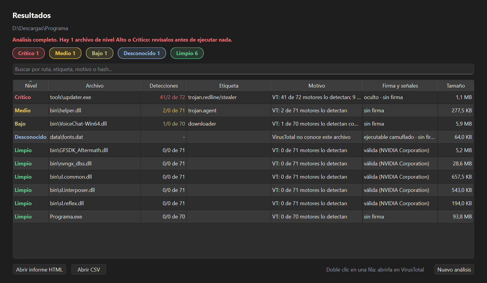

# vtscan

Programa para Windows que revisa una carpeta en busca de malware con VirusTotal. Busca los ejecutables y scripts que hay dentro, pregunta a VirusTotal si algún antivirus los detecta y te da un informe con los archivos ordenados de más a menos peligroso.

Está pensado para carpetas grandes, como programas descargados de fuentes no oficiales, y funciona con la cuenta gratuita de VirusTotal.



## Instalación

Necesitas Windows 10 u 11 y Python 3.11 o superior. En la carpeta del proyecto:

```powershell
python -m venv .venv
.\.venv\Scripts\python.exe -m pip install -r requirements.txt
```

También necesitas una clave de VirusTotal, que es gratis: crea una cuenta en [virustotal.com](https://www.virustotal.com) y copia la API key de tu perfil. La ventana te la pide la primera vez y la guarda en un archivo `.env` junto al programa, que nunca se sube al repositorio. Si solo usas la terminal, guárdala con este comando y abre una terminal nueva:

```powershell
setx VT_API_KEY "tu_clave"
```

## Uso con ventana

Haz doble clic en `vtscan_gui.pyw`. Arrastra una carpeta (o elígela), marca las opciones y pulsa **Analizar**.

Mientras analiza verás el progreso y lo que va encontrando. Con **Detener** se guarda lo hecho y puedes continuar más tarde. Al terminar tienes la tabla de resultados con filtros y buscador; con doble clic abres un archivo en VirusTotal, y los botones de abajo abren el informe HTML y el CSV.

**Calcular coste** te dice cuántas consultas y cuánto tiempo hará falta, sin gastar ninguna.

## Uso desde la terminal

```powershell
.\.venv\Scripts\python.exe vtscan.py "D:\Descargas\Programa"
```

Cuando termina, abre el informe en el navegador y lo guarda también en CSV para abrirlo con Excel.

Opciones que te pueden venir bien:

- `--dry-run`: calcula cuánto tardaría, sin hacer ninguna consulta.
- `--defender`: pasa antes Microsoft Defender por la carpeta. Solo avisa.
- `--upload`: sube a VirusTotal los archivos que no conoce. Antes te enseña la lista y te pregunta.
- `--all-files`: revisa todos los archivos, no solo los ejecutables.

Con `-h` ves todas.

## Por qué puede tardar

La versión gratuita de VirusTotal deja hacer 4 consultas por minuto y 500 al día. Una carpeta con 250 ejecutables tarda alrededor de una hora la primera vez. El programa espera solo y guarda cada respuesta para no repetir consultas.

Si se acaban las consultas del día, guarda lo que lleva y al día siguiente continúas (botón **Continuar** en la ventana, o `--resume` en la terminal). También puedes marcar que espere y siga solo (`--wait`).

## Cómo leer el informe

Cada archivo sale con un nivel y el motivo:

- Crítico: muchos antivirus lo detectan o varios lo señalan como malware peligroso, por ejemplo un ladrón de contraseñas o un ransomware. No lo ejecutes.
- Alto: varios antivirus lo detectan. Míralo en VirusTotal antes de usarlo.
- Medio y Bajo: una o dos detecciones, o detecciones genéricas. Muchas veces son falsos positivos, sobre todo en herramientas, parches y mods.
- Desconocido: VirusTotal no lo tiene. No quiere decir que sea seguro.
- Limpio: ningún antivirus lo detecta.

También pueden salir archivos pendientes (aún sin consultar) u omitidos (no se pudieron revisar, por ejemplo por ser demasiado grandes).

Una advertencia sobre la subida de archivos: lo que subes a VirusTotal lo pueden descargar otros investigadores, así que no subas archivos personales.

## Crear el .exe

```powershell
.\.venv\Scripts\python.exe -m pip install -r requirements-dev.txt
powershell -ExecutionPolicy Bypass -File .\build_exe.ps1
```

Genera `dist\vtscan-0.2.0-windows.zip` (unos 35 MB). Descomprímelo donde quieras y abre `vtscan.exe`; la caché y los informes se guardan dentro de esa misma carpeta. Como el .exe no lleva firma digital (cuesta dinero), la primera vez Windows puede avisar: pulsa "Más información" y luego "Ejecutar de todas formas".

## Configuración

En `config.toml` puedes cambiar qué extensiones se revisan, qué carpetas se saltan o cuántas detecciones hacen falta para cada nivel. Cada opción lleva un comentario.

## Tests

```powershell
.\.venv\Scripts\python.exe -m pip install -r requirements-dev.txt
.\.venv\Scripts\python.exe -m pytest
```

Funcionan sin conexión y sin clave.
