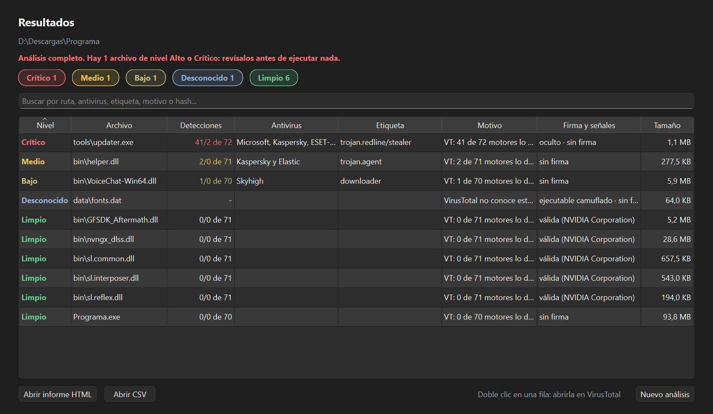

# vtscan

Revisa una carpeta con VirusTotal y te dice qué archivos pueden ser peligrosos. Está pensado para programas descargados de fuentes no oficiales y funciona con la cuenta gratuita de VirusTotal.



## Cómo se usa

1. Baja el zip de la [última versión](https://github.com/Mafallout/virustotal-folder-scanner/releases/latest), descomprímelo y abre `vtscan.exe`. No hace falta instalar nada.
2. Pega tu clave de VirusTotal. Es gratis: crea una cuenta en [virustotal.com](https://www.virustotal.com) y cópiala de tu perfil.
3. Arrastra una carpeta y pulsa "Analizar".

> [!NOTE]
> Como el .exe no va firmado, Windows puede avisar la primera vez: pulsa "Más información" y "Ejecutar de todas formas". En VirusTotal lo marcan 2 de 71 antivirus, con detecciones genéricas típicas de los programas hechos con PyInstaller.

## Qué te dice

| Nivel | Qué significa |
| --- | --- |
| Crítico | Muchos antivirus lo detectan, o varios lo ven como malware grave (un ladrón de contraseñas, un ransomware). No lo ejecutes. |
| Alto | Varios antivirus lo detectan. Míralo en VirusTotal antes de usarlo. |
| Medio y Bajo | Una o dos detecciones, o solo genéricas. Muchas veces son falsos positivos. |
| Desconocido | VirusTotal no lo tiene. No quiere decir que sea seguro. |
| Limpio | Ningún antivirus lo detecta. |

Al acabar tienes los resultados con filtros y buscador, y un informe en HTML y CSV.

## Cómo funciona

- Busca ejecutables y scripts, también los camuflados con otra extensión.
- A VirusTotal solo le manda el hash de cada archivo, no el archivo.
- Guarda cada respuesta, así que no repite consultas.
- La cuenta gratis deja 4 consultas por minuto y 500 al día, así que 250 ejecutables tardan una hora. Si se acaban, continúas otro día donde lo dejaste.
- Si quieres, pasa antes Microsoft Defender y sube los archivos que VirusTotal no conoce. Antes de subir te pregunta, porque lo que subes lo pueden descargar otros.

## Lo que no hace

- No es un antivirus: no vigila el ordenador ni borra nada.
- No abre comprimidos (.zip, .rar, .7z).
- Solo funciona en Windows 10 y 11.

## Desde el código

Con Python 3.11 o superior:

```powershell
python -m venv .venv
.\.venv\Scripts\python.exe -m pip install -r requirements-dev.txt
```

- Ventana: doble clic en `vtscan_gui.pyw`.
- Terminal: `.\.venv\Scripts\python.exe vtscan.py "D:\Descargas\Programa"`. Con `-h` ves las opciones.
- Tests: `.\.venv\Scripts\python.exe -m pytest`. Van sin conexión y sin clave.
- Crear el .exe: `powershell -ExecutionPolicy Bypass -File .\build_exe.ps1`.

Qué extensiones se revisan, qué carpetas se saltan y cuántas detecciones hacen falta para cada nivel se cambia en `config.toml`.

## Licencia

MIT. Las piezas de terceros y sus licencias están en `LICENCIAS-TERCEROS.txt`.
